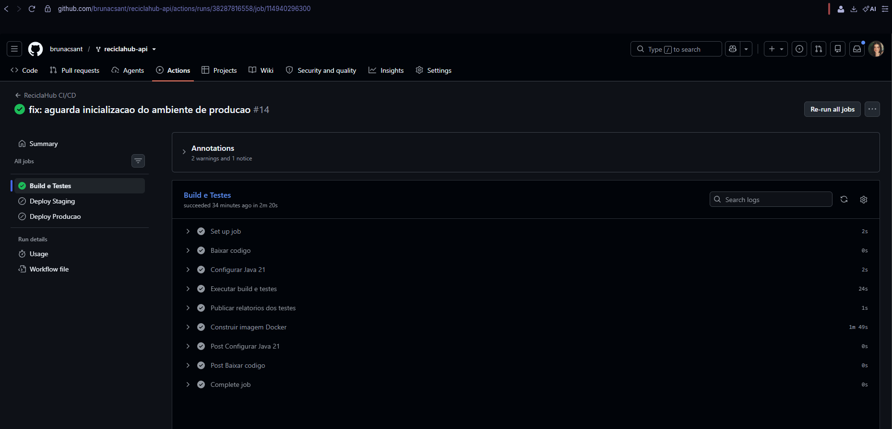
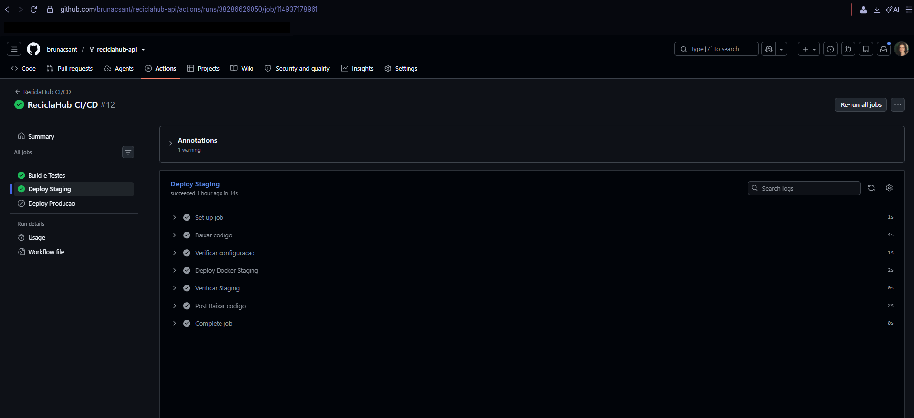
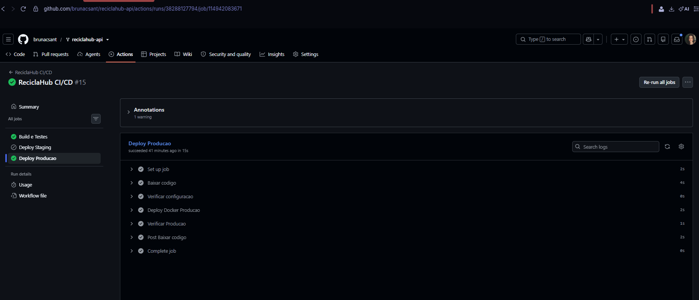
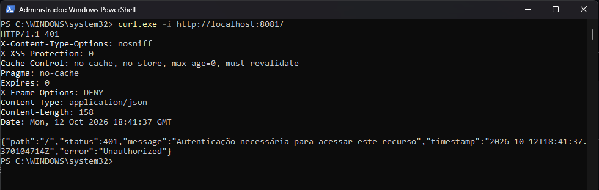
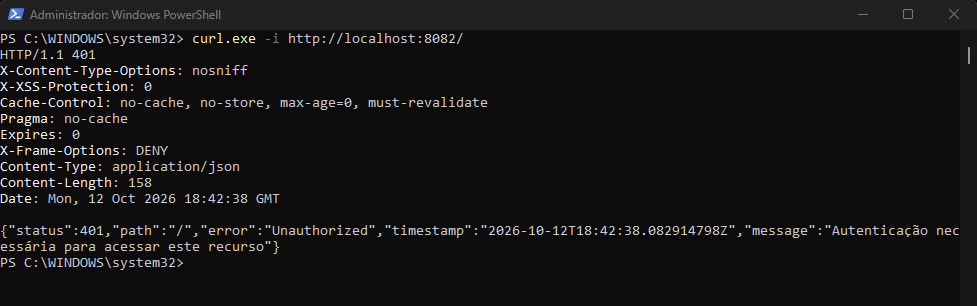

# Projeto - Cidades ESG Inteligentes

## ReciclaHub

**Plataforma Inteligente de Gestão Empresarial de Resíduos e Coletas Sustentáveis**

**Projeto acadêmico — Cidades ESG Inteligentes**

---

# 1. Visão Geral do Projeto

O **ReciclaHub** é uma plataforma empresarial voltada para a gestão inteligente de resíduos recicláveis, criada para atender empresas responsáveis pelo armazenamento e coleta de resíduos.

O objetivo do sistema é automatizar o monitoramento de resíduos, melhorar a eficiência operacional das coletas, reduzir desperdícios e fortalecer práticas ESG relacionadas à sustentabilidade ambiental.

A solução permitirá que empresas acompanhem em tempo real os níveis de armazenamento dos pontos de coleta, recebam alertas automáticos de capacidade excedida, acompanhem históricos de coletas e organizem operações logísticas de reciclagem de maneira segura e centralizada.

O projeto se enquadra no tema ESG: **Gestão de resíduos e reciclagem**, com foco em:

* rastreamento da coleta seletiva;
* descarte correto de resíduos;
* monitoramento de limites de armazenamento;
* automação de alertas ambientais;
* otimização da logística de coleta.

---

# 2. Problema Identificado

Atualmente, muitas empresas e centros de armazenamento de resíduos enfrentam dificuldades relacionadas ao controle operacional dos materiais recicláveis.

Entre os principais problemas observados estão:

* falta de monitoramento do volume armazenado;
* ausência de controle centralizado dos pontos de coleta;
* atrasos na coleta de resíduos;
* desperdício por excesso de armazenamento;
* baixa rastreabilidade sobre quais empresas realizaram as coletas;
* dificuldade de acompanhamento dos resíduos por categoria.

Além disso, empresas coletoras frequentemente não possuem uma visão clara dos locais prioritários para coleta, o que reduz a eficiência logística e pode gerar acúmulo excessivo de resíduos.

---

# 3. Solução Proposta

O ReciclaHub será uma API RESTful construída em Java com Spring Boot para gerenciar o ciclo operacional dos resíduos recicláveis.

O sistema conectará dois tipos principais de empresas:

## Empresa de Armazenamento

Responsável pelos pontos de coleta e pelo armazenamento temporário dos resíduos.

Essas empresas poderão:

* visualizar apenas os pontos pertencentes à sua organização;
* acompanhar níveis de armazenamento;
* visualizar alertas automáticos;
* acompanhar histórico de coletas realizadas;
* monitorar resíduos por categoria.

Por questões de segurança operacional, essas empresas **não poderão registrar coletas**, apenas acompanhá-las.

## Empresa Coletora

Responsável pela retirada dos resíduos recicláveis.

Essas empresas poderão:

* consultar resíduos disponíveis para coleta;
* visualizar armazenamento atual dos pontos;
* filtrar pontos por categoria de resíduo;
* registrar coletas;
* localizar pontos prioritários para retirada.

As empresas coletoras só poderão atuar nos tipos de resíduos autorizados em seu cadastro.

---

# 4. Como o Sistema Funcionará

## Etapa 1 — Cadastro e organização

A organização efetua um cadastro e, após efetuar login, implementa seus pontos de armazenamento para coleta:

* empresas de armazenamento;
* empresas coletoras;
* tipos de resíduos;
* pontos de coleta.

Cada ponto de coleta será vinculado a uma empresa responsável pelo armazenamento.

---

## Etapa 2 — Armazenamento de resíduos

Os resíduos são armazenados em pontos específicos.

Cada ponto possuirá:

* categoria de resíduo;
* quantidade atual armazenada;
* limite máximo permitido.

O sistema monitorará automaticamente os níveis de armazenamento.

---

## Etapa 3 — Geração automática de alertas

Quando um armazenamento ultrapassar o limite permitido da categoria de resíduo, o sistema gerará automaticamente um alerta.

Esse processo será realizado através de regras automatizadas no banco Oracle utilizando triggers.

Exemplo:

> Limite excedido para plástico no ponto Zona Norte.

A empresa responsável pelo ponto poderá visualizar imediatamente o problema.

---

## Etapa 4 — Consulta pelas empresas coletoras

As empresas coletoras visualizarão locais disponíveis para coleta com base nos tipos de resíduos autorizados.

Exemplo:

Uma empresa especializada em plástico verá apenas pontos com resíduos plásticos.

O sistema poderá priorizar locais com maior urgência de coleta.

---

## Etapa 5 — Registro da coleta

Após realizar a retirada do resíduo, a empresa coletora registrará a coleta no sistema.

O sistema automaticamente:

* registrará a operação;
* atualizará o armazenamento do ponto;
* reduzirá a quantidade armazenada.

Essa atualização ocorrerá automaticamente via trigger no Oracle.

---

## Etapa 6 — Histórico e auditoria

Todas as coletas ficarão registradas.

Será possível consultar:

* data da coleta;
* quantidade coletada;
* empresa responsável;
* categoria do resíduo;
* ponto de coleta.

Esse histórico servirá para auditoria e métricas ESG.

---

# 5. Diferenciais do Projeto

O sistema contará com:

### Controle de acesso por perfil

Cada empresa terá permissões específicas.

### Multiempresa

Cada organização visualizará apenas seus próprios dados.

### Segurança com Spring Security + JWT

Rotas protegidas com autenticação.

### Banco Oracle

Persistência robusta de dados.

### Flyway

Versionamento das migrações do banco.

### Docker

Execução padronizada em qualquer ambiente.

### Automação no banco

Uso de triggers para:

* validação de dados;
* atualização automática do armazenamento;
* geração automática de alertas.

---

# 6. Tecnologias utilizadas

| Tecnologia | Utilização |
|---|---|
| Java 21 | Linguagem de programação da API |
| Spring Boot 3.5.6 | Framework principal da API REST |
| Spring Web | Exposição de endpoints HTTP |
| Spring Security | Autenticação e autorização |
| JWT / JJWT | Emissão e validação de tokens de acesso |
| BCrypt | Armazenamento seguro das senhas dos usuários |
| Spring Data JPA | Persistência de dados |
| Bean Validation | Validação das requisições |
| Oracle Database / Oracle Free 23c | Banco de dados relacional |
| Flyway | Versionamento de migrações do banco |
| Maven / Maven Wrapper | Dependências, build e execução dos testes |
| JUnit / Spring Boot Test | Infraestrutura de testes automatizados |
| Docker | Construção e execução de imagens |
| Docker Compose | Orquestração do Oracle e das instâncias da API |
| Git e GitHub | Controle de versão e hospedagem do código |
| GitHub Actions | Automação de CI/CD |
| Self-hosted Runner Windows | Execução dos deploys no Docker Desktop local |
| Postman / Insomnia | Ferramentas de teste manual dos endpoints |

---

# 7. Objetivo Final do Produto

O objetivo do ReciclaHub é fornecer uma plataforma corporativa capaz de tornar o processo de armazenamento e coleta de resíduos mais eficiente, rastreável e sustentável.

Com isso, empresas poderão reduzir desperdícios, melhorar a logística de reciclagem e fortalecer práticas ESG através do monitoramento inteligente dos resíduos recicláveis.

---

# 8. Segurança (Spring Security + JWT)

A API é protegida por **Spring Security** com autenticação baseada em **JWT**. As senhas são armazenadas com **BCrypt**.

## Endpoints públicos

| Método | Endpoint | Descrição |
|---|---|---|
| POST | `/api/cadastro/empresa` | Cadastra uma nova empresa |
| POST | `/api/auth/login` | Realiza login e retorna token JWT |

Todos os demais endpoints exigem o cabeçalho:

```http
Authorization: Bearer <token-jwt>
```

## Fluxo de uso

1. **Cadastrar empresa** (`POST /api/cadastro/empresa`):

```json
{
  "cnpj": "12345678000199",
  "nome": "Empresa Exemplo",
  "email": "empresa@exemplo.com",
  "senha": "senhaSegura123",
  "tipo": "ARMAZENAMENTO"
}
```

2. **Realizar login** (`POST /api/auth/login`):

```json
{
  "email": "empresa@exemplo.com",
  "senha": "senhaSegura123"
}
```

Resposta de exemplo:

```json
{
  "token": "eyJhbGciOiJIUzI1NiJ9...",
  "tipoToken": "Bearer",
  "expiracaoMs": 3600000,
  "idEmpresa": 1,
  "nome": "Empresa Exemplo",
  "email": "empresa@exemplo.com",
  "tipo": "ARMAZENAMENTO"
}
```

3. **Usar o token** nas demais chamadas via cabeçalho `Authorization: Bearer <token>`.

## Roles (perfis)

O campo `tipo` da empresa é mapeado como uma role do Spring Security:

- `ARMAZENAMENTO` → `ROLE_ARMAZENAMENTO`
- `COLETORA` → `ROLE_COLETORA`

Restrições adicionais podem ser definidas por endpoint usando `@PreAuthorize` (já habilitado via `@EnableMethodSecurity`).

---

# 9. Como executar localmente com Docker

O projeto possui `Dockerfile` multi-stage e `docker-compose.yml` para iniciar **Oracle Free 23c** e a API. O arquivo `docker-compose.environments.yml` define instâncias adicionais para staging e produção.

## Pré-requisitos

- Docker Desktop ou Docker Engine, com Docker Compose;
- Portas `8080` (API local) e `1522` (Oracle) disponíveis, ou ajustadas no `.env`;
- Para staging e produção, portas `8081` e `8082` disponíveis.

## Passo a passo

1. Na raiz do projeto, copie o arquivo de exemplo das variáveis de ambiente.

   **PowerShell (Windows):**

   ```powershell
   Copy-Item .env.example .env
   ```

   **Linux/macOS:**

   ```bash
   cp .env.example .env
   ```

2. Edite o `.env` com os valores adequados de `ORACLE_PASSWORD`, `ORACLE_APP_USER`, `ORACLE_APP_PASSWORD` e `JWT_SECRET`. Não compartilhe esse arquivo com credenciais reais. Em ambientes não acadêmicos, não utilize os valores padrão de exemplo.

3. Suba os contêineres:

   ```bash
   docker compose up -d --build
   ```

4. Confira o estado dos serviços e acompanhe os logs. O Oracle pode levar alguns minutos para ficar pronto na primeira inicialização.

   ```bash
   docker compose ps
   docker compose logs -f api
   ```

5. A API estará disponível em `http://localhost:8080`.

   **Teste pelo PowerShell:**

   ```powershell
   curl.exe -i http://localhost:8080/
   ```

   **Observação:** o retorno `HTTP 401 Unauthorized` na rota `/` é esperado porque ela exige autenticação. Essa resposta confirma que o servidor HTTP atende às requisições, mas não substitui testes funcionais dos endpoints.

6. Para encerrar sem remover o volume persistente do banco:

   ```bash
   docker compose down
   ```

   **Atenção:** o comando `docker compose down -v` também remove o volume de dados do Oracle. Utilize-o somente se desejar apagar os dados persistidos.

## Variáveis de ambiente principais

| Variável | Utilização | Padrão no Compose principal |
|---|---|---|
| `ORACLE_PASSWORD` | Senha administrativa do Oracle | `oracle` |
| `ORACLE_APP_USER` | Usuário da aplicação no Oracle | `reciclahub` |
| `ORACLE_APP_PASSWORD` | Senha do usuário da aplicação | `reciclahub` |
| `ORACLE_PORT` | Porta do Oracle exposta no computador | `1522` |
| `API_PORT` | Porta da API principal no computador | `8080` |
| `JWT_SECRET` | Segredo de assinatura dos tokens JWT | Valor de exemplo definido no Compose principal |
| `JWT_EXPIRATION_MS` | Validade dos tokens em milissegundos | `3600000` |

Os parâmetros `SPRING_DATASOURCE_URL`, `SPRING_DATASOURCE_USERNAME`, `SPRING_DATASOURCE_PASSWORD`, `JWT_ISSUER` e `SERVER_PORT` são disponibilizados à aplicação pelo Docker Compose. A URL JDBC no Docker aponta para `jdbc:oracle:thin:@oracle-db:1521/FREEPDB1`.

## Ambientes de staging e produção

Os ambientes são definidos em `docker-compose.environments.yml`:

| Ambiente | Container | Endereço | Porta do host |
|---|---|---|---|
| API principal | `reciclahub-api` | `http://localhost:8080` | `8080` |
| Staging | `reciclahub-staging` | `http://localhost:8081` | `8081` |
| Produção | `reciclahub-production` | `http://localhost:8082` | `8082` |

Para executá-los manualmente, inicie primeiro o Oracle pelo Compose principal, garantindo a rede Docker utilizada pelos serviços:

```bash
docker compose up -d oracle-db
```

Depois, com o `.env` configurado:

```bash
docker compose -f docker-compose.environments.yml -p reciclahub-env up -d --build staging
docker compose -f docker-compose.environments.yml -p reciclahub-env up -d --build production
```

**Limitação da infraestrutura:** staging e produção são contêineres executados na mesma máquina e compartilham o Oracle local. Não representam hospedagem pública nem isolamento completo dos ambientes.

---

# 10. Execução local (sem Docker)

```bash
./mvnw spring-boot:run
```

No Windows, também é possível executar:

```powershell
.\mvnw.cmd spring-boot:run
```

Por padrão, a aplicação utiliza o Oracle da FIAP (`oracle.fiap.com.br`). Para apontar para outro banco, defina as variáveis `SPRING_DATASOURCE_URL`, `SPRING_DATASOURCE_USERNAME` e `SPRING_DATASOURCE_PASSWORD`. É necessário que o banco esteja acessível para a inicialização da aplicação.

---

# 11. Pipeline CI/CD

A integração e a implantação são automatizadas pelo **GitHub Actions**, conforme o workflow em [`.github/workflows/ci-cd.yml`](.github/workflows/ci-cd.yml).

## Integração contínua (CI)

O job **Build e Testes** utiliza um runner hospedado pelo GitHub com **Ubuntu**. Sua execução ocorre em `push` para `master`, em `pull_request` direcionado a `master` e em acionamentos manuais (`workflow_dispatch`).

Etapas executadas:

1. Baixar o código com `actions/checkout@v4`.
2. Preparar o **Java 21** com `actions/setup-java@v4`.
3. Disponibilizar as credenciais de conexão com o Oracle por GitHub Actions Secrets: `DB_URL`, `DB_USERNAME` e `DB_PASSWORD`.
4. Executar o Maven Wrapper com `./mvnw clean verify` para compilar e executar os testes.
5. Publicar os relatórios de teste disponíveis como artefatos do GitHub Actions.
6. Validar a construção da imagem por meio de `docker build`.

Se o job de CI falhar, os jobs de deploy que dependem dele não são executados.

## Implantação contínua sob acionamento manual (CD)

Os jobs **Deploy Staging** e **Deploy Producao** são executados somente quando o workflow é iniciado manualmente pela opção **Run workflow**, na branch `master`, com a seleção do ambiente desejado (`staging` ou `production`). A CI é executada antes do deploy selecionado.

Os deploys utilizam um **Self-hosted Runner Windows** conectado ao GitHub e com acesso ao Docker Desktop da máquina local. Cada job:

1. Baixa o código da versão selecionada.
2. Confere o acesso ao Docker, à rede compartilhada e às configurações necessárias.
3. Executa `docker compose` para construir a imagem e iniciar ou atualizar o contêiner do ambiente.
4. Aguarda a inicialização e verifica a resposta HTTP da API (`8081` para staging ou `8082` para produção).

A API possui autenticação com Spring Security. Por isso, o retorno `401 Unauthorized` na rota `/` é aceito pela checagem de disponibilidade. Ele indica que a API responde, não que todos os endpoints ou operações de banco foram testados.

Os secrets do GitHub são utilizados para as credenciais da CI e para a configuração de deploy. Os valores reais não devem constar no README, no ZIP ou em capturas de tela.

**Funcionamento da infraestrutura:** o runner Windows precisa estar conectado, com o computador ligado e o Docker Desktop em execução. A imagem é construída novamente durante o deploy local; a imagem produzida no job Ubuntu não é publicada em um registry para reutilização.

**Repositório:** [github.com/brunacsant/reciclahub-api](https://github.com/brunacsant/reciclahub-api)

---

# 12. Containerização

A aplicação é empacotada com um **Dockerfile multi-stage**, separando o ambiente de build do ambiente de execução.

## Conteúdo do Dockerfile

```dockerfile
# =========================
# Stage 1 - Build
# =========================
FROM eclipse-temurin:21-jdk-alpine AS builder

WORKDIR /build

# Copia wrappers e arquivos do Maven primeiro para aproveitar cache de dependências
COPY mvnw mvnw.cmd pom.xml ./
COPY .mvn ./.mvn

RUN chmod +x mvnw && ./mvnw -B -q dependency:go-offline

# Copia o código-fonte e empacota
COPY src ./src
RUN ./mvnw -B -q clean package -DskipTests

# =========================
# Stage 2 - Runtime
# =========================
FROM eclipse-temurin:21-jre-alpine

# Cria um usuário não-root por segurança
RUN addgroup -S spring && adduser -S spring -G spring

WORKDIR /app

COPY --from=builder /build/target/*.jar app.jar

RUN chown -R spring:spring /app
USER spring

EXPOSE 8080

ENV JAVA_OPTS=""

ENTRYPOINT ["sh", "-c", "java $JAVA_OPTS -jar /app/app.jar"]
```

## Estratégias adotadas

- **Multi-stage build:** a etapa inicial utiliza o JDK para compilar a aplicação, enquanto a etapa final utiliza o JRE para execução.
- **Imagens Alpine:** utilização de imagens compactas do Eclipse Temurin com Java 21.
- **Cache de dependências:** cópia antecipada dos arquivos Maven antes do código-fonte.
- **Usuário não-root:** execução da aplicação com o usuário `spring` dentro do contêiner.
- **Configuração externa:** utilização de variáveis de ambiente para banco de dados e autenticação.
- **Persistência dos dados:** volume Docker nomeado `oracle-data` para armazenar dados do Oracle entre reinicializações.
- **Orquestração:** `docker-compose.yml` para Oracle e API principal; `docker-compose.environments.yml` para staging e produção.
- **Testes separados da imagem:** o Dockerfile utiliza `-DskipTests` durante o empacotamento, pois a pipeline executa os testes anteriormente com `./mvnw clean verify`.

---

# 13. Prints do funcionamento

As evidências da execução da pipeline e do funcionamento dos ambientes estão organizadas em `docs/evidencias/`.

## Link de alguns deploys do projeto 
https://github.com/brunacsant/reciclahub-api/actions/runs/38288127794
https://github.com/brunacsant/reciclahub-api/actions/runs/38287816558
https://github.com/brunacsant/reciclahub-api/actions/runs/38286629050


## Build e testes



## Deploy de staging



## Deploy de produção



## Validação da API de staging

**Registro da requisição (PowerShell):**

```powershell
curl.exe -i http://localhost:8081/
# HTTP/1.1 401 Unauthorized
# message: Autenticação necessária para acessar este recurso
```



## Validação da API de produção

**Registro da requisição (PowerShell):**

```powershell
curl.exe -i http://localhost:8082/
# HTTP/1.1 401 Unauthorized
# message: Autenticação necessária para acessar este recurso
```



Os testes de disponibilidade realizados nas portas `8081` e `8082` retornaram `HTTP 401 Unauthorized`, resultado esperado para uma requisição sem autenticação na rota `/`.

O histórico de execuções também pode ser consultado em [GitHub Actions — ReciclaHub](https://github.com/brunacsant/reciclahub-api/actions).

> **Nota de segurança:** não inclua o arquivo `.env` nem tokens reais no ZIP. As respostas HTTP acima foram registradas em texto a partir dos testes apresentados, não são capturas de tela.


---

# 14. Desafios encontrados e soluções

| Desafio | Solução aplicada |
|---|---|
| Falhas de resolução de nomes no Windows durante a configuração do ambiente | Ajuste da configuração de DNS e validação da resolução de nomes. |
| Falha no build por falta de acesso ao banco acadêmico na CI | Configuração das variáveis `DB_URL`, `DB_USERNAME` e `DB_PASSWORD` nos GitHub Actions Secrets. |
| Runner Windows não encontrava `pwsh` | Troca para `shell: powershell`, disponível no ambiente do runner. |
| Nome de container Docker já utilizado | Remoção dos containers antigos de staging e produção, preservando o banco e seus volumes. |
| Verificação HTTP executada antes da inicialização do Spring Boot | Implementação de tentativas de verificação com espera de até aproximadamente dois minutos. |

---

# 15. Checklist de entrega (obrigatório)

| Item | Situação |
|---|---|
| Projeto compactado em `.ZIP` com estrutura organizada | ☑ Pendente: conferir e gerar o ZIP final com o código-fonte |
| Dockerfile funcional | ☑ Validado por build Docker bem-sucedido |
| `docker-compose.yml` ou arquivos Kubernetes | ☑ Docker Compose utilizado |
| Pipeline com etapas de build, teste e deploy | ☑ GitHub Actions executado com sucesso |
| README.md com instruções e prints | ☑ Incluído neste arquivo, acompanhado da pasta `docs/evidencias` |
| Documentação técnica com evidências (PDF ou PPT) | ☑ PDF técnico criado e disponibilizado separadamente |
| Deploy realizado nos ambientes staging e produção | ☑ Ambos concluídos e validados por resposta HTTP |

**Conferências finais antes de enviar:** preencher os nomes dos integrantes no PDF; incluir o PDF no ZIP; compactar o projeto completo sem `.env` real, `.git` ou outros arquivos com segredos.
